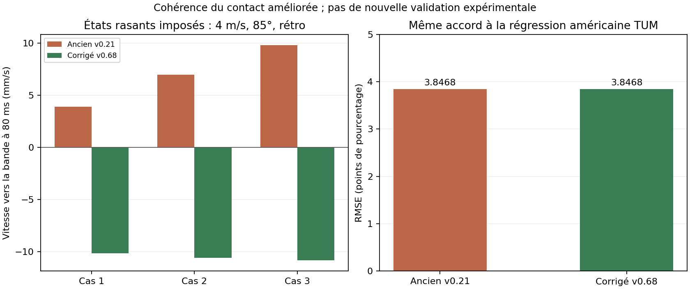

# FRAME v0.68 — correction de contact et comparaison avec v0.21

## Résultat

La correction améliore la **cohérence géométrique du contact** dans les cas
rasants diagnostiqués. Elle ne modifie ni les coefficients de tapis ni les
paramètres effectifs de bande de v0.21.

Sur les références américaines disponibles dans le dépôt, les résultats sont
**identiques**, pas meilleurs : RMSE **3,8468374436 points** pour chacun des deux
modèles sur les 24 composantes de la régression TUM déjà utilisée pour leur
calibration. Aucune nouvelle mesure indépendante avec effet n'est disponible.
On ne peut donc pas annoncer un gain expérimental global de réalisme.

Le nouveau modèle est sélectionné par défaut dans le jeu. L'ancien v0.21
reste accessible dans « Modèle de bande » pour les comparaisons.

## Défaut et correction

Pour une sphère, la rotation ne change pas la distance géométrique entre son
centre et la bande. Or v0.21 pouvait utiliser la vitesse d'un point tournant
pour considérer le contact comme séparé alors que le centre avançait encore
vers la bande. La réparation de position supprimait la pénétration, mais
laissait une petite vitesse résiduelle dirigée vers la bande.

Le modèle `coupled-v068` :

1. Détermine l'approche géométrique avec la vitesse du centre, pour les nez
   de bande du profil pool. La recherche continue d'impact et la réparation
   discrète emploient le même critère.
2. Réutilise le solveur et tous les paramètres de v0.21.
3. Si le centre avance encore vers la bande à la sortie, applique la
   correction passive minimale pour imposer `v_normale >= 0`. Il n'ajoute
   aucune vitesse élastique de rebond.

Cette correction peut se représenter par une impulsion radiale du nez de
bande, de couple nul sur la sphère, et une réaction verticale du tapis dans
l'hypothèse existante de hauteur contrainte. La translation tangentielle et
la rotation ne sont pas modifiées par cette projection. L'énergie cinétique
retirée vaut `0,5 * m * v_normale_residuelle²`.

C'est une correction de contrainte, **pas** une nouvelle identification de
la gomme K55/K66, du frottement ou de la restitution. Le modèle conserve ses
limites : hauteur fixe, absence de saut et de contact vertical entièrement
résolu. Le candidat simultané v0.22 reste séparé et non activé.

## Comparaison numérique exécutée

Commande :

```bash
node scripts/compare-pool-v068.js
```

Le script régénère [les résultats détaillés](data/pool-v068-comparison.json).
Il n'ajuste aucun paramètre physique et retourne un code d'erreur si les
critères de cohérence, convergence ou non-régression ne sont pas respectés.

Configuration commune : billes américaines **57,15 mm / 170,097 g**, profil
`pool`, hauteur de nez **36,29025 mm**. Frottements du tapis inchangés :
glissement `0,20`, roulement `0,01`, rotation verticale `0,015` dans la
convention du moteur.

| Contrôle | Ancien v0.21 | Corrigé v0.68 |
|---|---:|---:|
| Conditions de bande | 970 | 970 |
| Simulations normales / miroir / pas plus fin | 2 910 | 2 910 |
| États non finis ou saturation d'événements | 0 | 0 |
| Gain d'énergie détecté aux instants observés | 0 | 0 |
| Écart de symétrie gauche/droite | 0 | 0 |
| Cas avec vitesse résiduelle vers la bande à 80 ms | **3** | **0** |
| Écart maximal de position 240 Hz / 960 Hz à 80 ms | 0,0350 mm | 0,0350 mm |
| RMSE sur les 24 composantes TUM | **3,8468 points** | **3,8468 points** |
| MAE sur ces composantes TUM | 2,7833 points | 2,7833 points |

La matrice comprend :

- **700 états imposés**, avec vitesses de 0,25 à 4 m/s, angles de 0° à 85°,
  cinq effets latéraux et quatre états rétro/coulé.
- **270 états issus de la frappe du jeu**, neuf points d'impact valides,
  six angles et cinq forces. Leur vitesse réellement obtenue dépend du
  point d'impact ; le paramètre de force est la référence de frappe centrée.
- Pour chaque modèle : pas principal de 1/240 s, cas en miroir, puis 1/960 s.
  Les observations sont faites à 80 ms depuis une position à 1 micromètre
  avant le contact, pour isoler le modèle de bande.

**10 conditions sur 970** changent, toutes des états imposés avec rétro et
impact rasant. **Aucune des 270 conditions générées par la frappe ne change**
dans cette matrice, y compris les rotations et positions comparées.
Le script conserve les états avant/après des dix conditions modifiées.

### Les trois cas précédemment signalés

À 4 m/s, sous 85° à la normale, avec un rapport de rétro imposé de −1 :

| Rapport d'effet latéral imposé | Ancienne vitesse vers la bande à 80 ms | Nouvelle vitesse vers la bande à 80 ms |
|---|---:|---:|
| −2 | +3,902 mm/s | −10,161 mm/s |
| +1 | +6,966 mm/s | −10,612 mm/s |
| +2 | +9,784 mm/s | −10,839 mm/s |

Le signe négatif signifie que le centre s'éloigne de la bande. Ces états
extrêmes ne sont pas tous obtenables par une frappe directe ordinaire ; ils
servent à tester les états de rotation pouvant être imposés au solveur.
Ils se trouvent aussi hors de la grille TUM exécutée ici.



### Tapis et contrôles logiciels

Les **34 contrôles analytiques du tapis** passent. Ils vérifient le
roulement, le passage glissement–roulement avec rétro/coulé, la perte d'effet
latéral et les seuils d'arrêt. Les paramètres du tapis n'ont pas changé.

La suite logicielle comprend les tests ciblés supplémentaires du contact,
de l'observation avant/après choc, de l'indépendance du profil snooker, des
symétries et de l'assistance de trajectoire. La vérification Chromium teste
le choix des deux modèles, le diagnostic et le replay.

## Ce que les études américaines permettent réellement de comparer

### Nierhoff, Heunisch & Hirche — pool américain

[Strategic play for a pool-playing robot](https://mediatum.ub.tum.de/doc/1155344/988748.pdf).

Les régressions déjà présentes dans le projet, rapportées à partir de
**1 217 impacts**, fournissent ici 24 valeurs de composantes normale et
tangentielle après retour au roulement. Le script emploie les vitesses
0,5 / 1,2 / 2,3 m/s et les angles 30° / 45° / 60° / 75°.

Ces valeurs calculées à partir de la régression ne sont ni 24 nouvelles
mesures ni les 1 217 données brutes. Les deux modèles réutilisent la même
calibration et obtiennent exactement les mêmes scores. Aucun rebond avec
effet latéral indépendant n'est ajouté à cette validation.

### Alciatore — repère indicatif de pool

[HSV B.15 / TP B.6](https://drdavepoolinfo.com/technical_proofs/new/TP_B-6.pdf)
est déjà cité dans le projet pour l'ordre de grandeur d'environ 50 % de
vitesse conservée après le glissement d'un rebond presque perpendiculaire.

Dans l'essai diagnostique à 1,6 m/s, les deux modèles conservent **58,2256 %**.
Ce résultat est inchangé. Le repère « environ 50 % » ne documente pas une
vitesse et une table précises suffisantes pour définir une nouvelle erreur
expérimentale à 1,6 m/s ; il n'est pas utilisé pour retoucher les paramètres.

### Sources qui ne deviennent pas des calibrations américaines

- **Mathavan 2009** : montage de snooker avec billes de 52,4 mm, conservé
  comme comparaison historique distincte dans les tests existants.
- **Mathavan 2010** : les reproductions consultées utilisent 52,5 mm et
  140,6 g ; leurs coefficients ne sont pas copiés dans la correction.
  [Paramètres reproduits dans Pooltool](https://github.com/ekiefl/pooltool/blob/main/pooltool/physics/resolve/ball_cushion/mathavan_2010/_plots.py).
- **Han et données Tailuge** : carambole/trois-bandes, utiles pour la méthode
  et les vérifications de signe, pas pour les cibles chiffrées de pool.
- **Gismeros Moreno 2022** : le candidat de recherche de contacts multiples
  reste séparé ; aucun coefficient de ce travail n'est nouvellement adopté.

Les PDF originaux académiques restent inaccessibles par le réseau de cet
environnement. Cette comparaison réutilise les références auditées dans le
projet ; elle ne prétend pas avoir revérifié ici les données brutes de ces
articles ni avoir filmé une nouvelle série de tirs américains.

## Tester dans le jeu

1. Dans le laboratoire sous la table, choisir **Diagnostic · bande rasante**,
   puis **Charger**.
2. Choisir le modèle de bande v0.21 ou v0.68 dans les options avancées.
3. Tirer, puis ouvrir **Vitesse et effet avant / après bande**. Les valeurs
   correspondent au premier choc de la blanche, avant le glissement suivant.
4. Recharger le même exercice, changer le modèle et répéter. Cet exercice
   est une frappe directe ordinaire : il reste identique dans les deux
   modèles ; les cas de contrainte extrêmes sont reproduits par le script.

Le replay conserve le modèle réellement employé lors de l'enregistrement.
L'exercice et ses mesures sont des simulations, pas des observations réelles.

## Conclusion sur le réalisme

**Cohérence mécanique : améliorée sur les cas identifiés. Accord à l'étude
américaine utilisée : inchangé. Gain expérimental de précision avec effet :
non établi faute de mesures indépendantes.**

La correction peut être testée dans le jeu sans nouvelle calibration. Pour
aller plus loin sur le réalisme des effets, la prochaine preuve utile reste
un jeu de mesures sur une table américaine avec vitesses angulaires connues
avant et après bande, ainsi qu'après retour au roulement.
