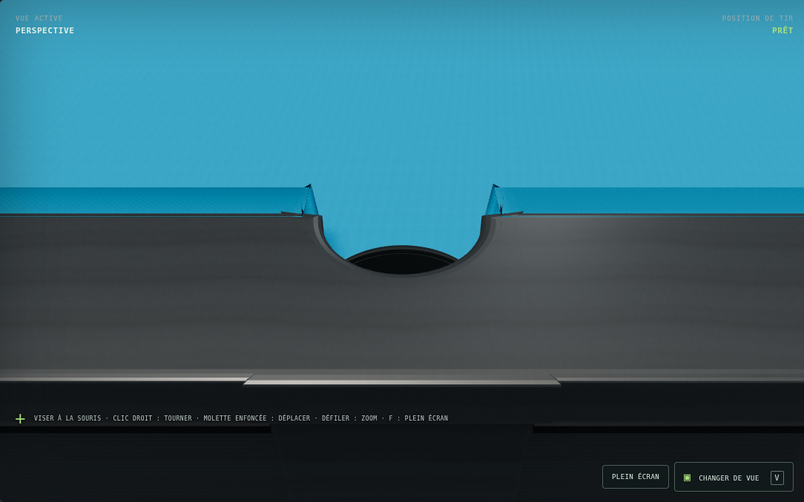
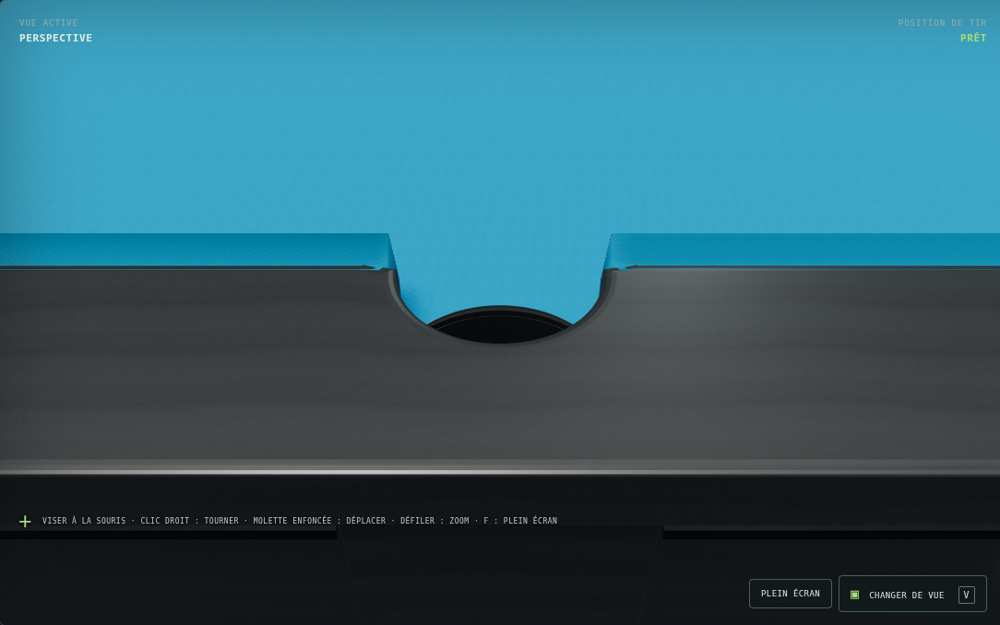
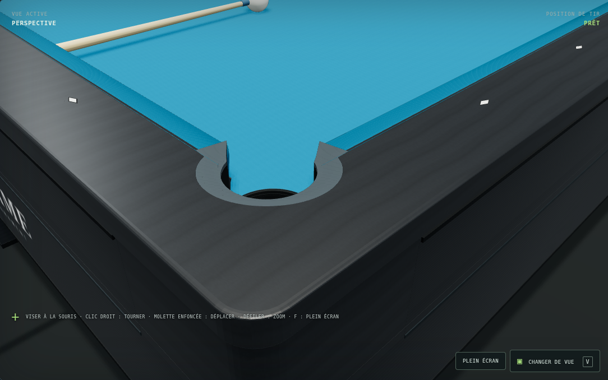

# FRAME v0.73 — raccords visuels des bandes

13 novembre 2026.

## Ce qui change

Les six bandes restent des volumes continus, mais leurs raccords aux mâchoires
utilisent maintenant **une section de mitre commune**. L'ancien raccord reliait
deux sections différentes au même endroit : leur différence de largeur et de
hauteur créait une petite face verticale ou une pointe visible. La nouvelle
section est construite à l'intersection des déports du profil droit et du profil
de mâchoire. Le nez et les deux extrémités de chaque segment restent aux mêmes
positions ; l'épaulement étroit descend progressivement vers la poche.

La direction de construction de la face visuelle est calculée à partir de sa
tangente géométrique. Elle est indépendante de la normale utilisée par le moteur
de collision, qui n'est pas modifiée.

Sur les pièces graphite, les biseaux sont arrêtés au plan d'assemblage commun.
Ils ne débordent plus de part et d'autre du raccord. Les bords extérieurs gardent
leur arrondi ; le profil de biseau des raccords de poche est aligné sur celui des
capots droits. Les faces internes coplanaires sont retirées pour éviter qu'elles
ne projettent une ombre pointillée sur la jonction affleurante. Les UV et les
textures de la version 0.72 sont conservées.

## Portée

Seuls les six maillages de caoutchouc et les douze capots/raccords supérieurs
changent. L'export géométrique permet de comparer séparément les autres groupes.
La découpe du tapis, les puits, les inserts graphite, les repères, le meuble et
les billes restent inchangés. L'éclairage de la 0.72 est conservé.

Les fichiers de physique et la référence partagée des ouvertures ne sont pas
modifiés. Le modèle actif reste `reference-v069` ; cette livraison n'ajuste ni
les rebonds ni les coefficients.

## Relecture croisée

Deux agents se partagent le travail : raccords bleus et raccords graphite.
Chacun relit le plan, le code et les images de l'autre.

La première passe supprimait les marches des capots, mais accentuait des ailettes
bleues près des poches ; les gros plans l'ont fait rejeter malgré des contrôles
géométriques réussis. Elle a été remplacée par la section commune. Une ombre
pointillée sur les joints graphite a également conduit à supprimer les faces
internes superposées. La seconde passe est comparée avec les mêmes caméras avant
la validation finale.

## Comparaison des raccords

Poche latérale avant :



Poche latérale après :



Coin avant :


Coin après :



Captures Chromium / WebGL 2 logiciel, fenêtre 1 600 × 1 100, caméras et éclairage
identiques. Il ne s'agit pas d'une comparaison des performances sur du matériel
de jeu.

## Contrôles à reproduire

```bash
npm test
node scripts/export-table-geometry.mjs
```

Les contrôles existants conservent la fermeture des six volumes de caoutchouc,
l'absence de triangles dégénérés, la liaison aux extrémités des mâchoires, la
symétrie et l'absence de débordement sur le tapis jouable. Les hauteurs des capots
et des incrustations restent affleurantes.

L'ancienne assertion imposant exactement 40 sommets par bande décrivait les deux
sections du raccord remplacé. Elle est remplacée par des propriétés de soudure
et de continuité ; le test ne fige pas le nombre de sommets de la nouvelle
implémentation. Les contrôles de fermeture et d'aire des triangles sont maintenus.

## Résultats de livraison

- 256 tests réussis, sans échec, ignoré ou annulé ; les dix contrôles ciblés des
  raccords et de la construction de table passent également.
- Quatre contrôles supplémentaires couvrent les plans d'assemblage des capots,
  l'absence de triangles dégénérés, le retrait des parois internes et l'absence
  d'ailette verticale directement au-dessus du nez de mâchoire.
- Export final : 162 maillages et 31 268 triangles, contre 31 844 triangles en
  0.72. Seuls les groupes `innerRailMaterial` (six maillages) et `railMaterial`
  (douze maillages) changent ; les autres sommets et triangles sont identiques.
- Gros plans des poches latérales, d'un coin et d'une jonction de bordure sans
  erreur JavaScript dans Chromium. Les deux agents ont examiné les images
  corrigées après leur relecture réciproque du code et des tests.
- Vue joueur près d'une bande : découpe de visibilité active, sans erreur
  JavaScript ni échec de chargement.
- Tir en entraînement jusqu'à l'arrêt, replay disponible, ouverture, déplacement
  du curseur et fermeture fonctionnels. Le modèle sélectionné reste
  `reference-v069`.
- Cinq réinitialisations de formation : compteurs graphiques stables à 321
  géométries et 22 textures. Le jeu fonctionne aussi en bloquant les requêtes
  externes ; seule l'erreur réseau attendue des polices Google est relevée.

Ces résultats vérifient la correction visuelle et la non-régression logicielle ;
ils n'ajoutent aucune validation expérimentale du comportement des bandes.
