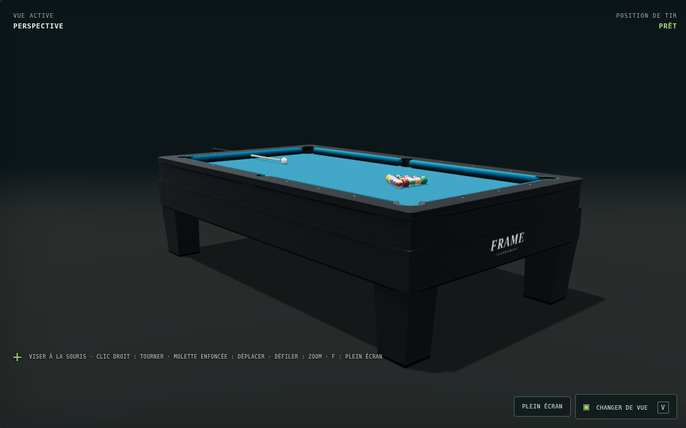
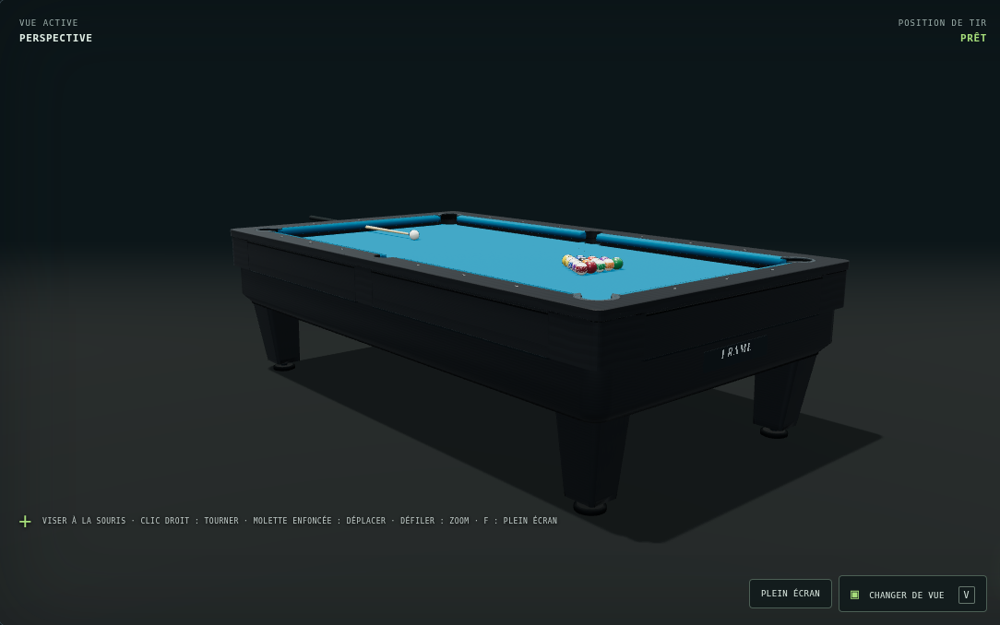
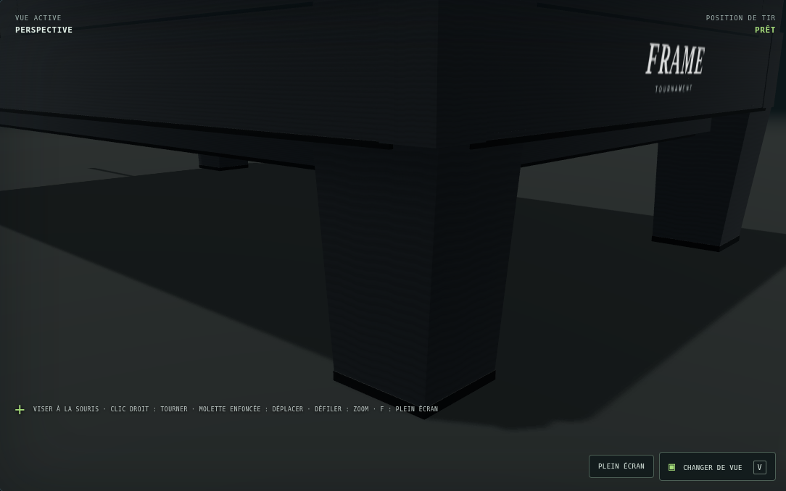
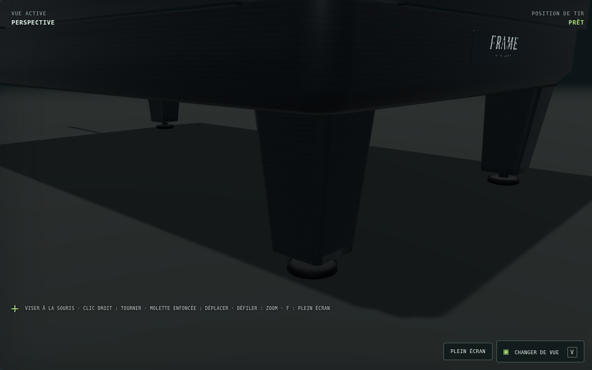

# FRAME v0.74 — meuble de la table

13 novembre 2026.

## Aspect et construction

Le meuble conserve la finition graphite et le plateau bleu. L'empilement de
panneaux rectangulaires est remplacé par une caisse creuse continue, avec coins
arrondis, chants supérieurs et dépouille inférieure intégrés au même volume.
La structure sous l'ardoise et les passages de poche restent en place.

Quatre pieds arrondis et effilés entrent dans les coins du meuble. Leur base
comporte une tige et un patin circulaire de mise à niveau. Les semelles reposent
sur le sol à `y=-0,760 m` ; la partie supérieure des pieds reste sous les sacs
et dans le contour réel de la caisse.

Le grand marquage en façade devient une plaque compacte à coins arrondis,
modélisée sur 3 mm d'épaisseur et adossée à la façade. Son marquage et ses quatre
petites empreintes de vis partagent une texture locale éclairée. L'impression
est séparée du corps de 0,3 mm et utilise un décalage de profondeur pour éviter
les conflits à distance. Aucune ressource externe n'est ajoutée.

## Portée conservée

La comparaison des exports avant/après retrouve à l'identique les sommets et
triangles des **120 maillages de la partie supérieure**, sélectionnés par leur
présence au-dessus de `y=-0,1149 m`. Cela inclut les bandes, leurs raccords v0.73,
les capots, les repères, le tapis et les éléments supérieurs des poches.

Les fichiers de physique, la référence partagée des ouvertures et l'éclairage
sont inchangés. Le modèle actif reste `reference-v069`. Cette mise à jour porte
sur l'habillage, les pieds et la marque du meuble.

## Relecture par deux agents

- L'agent meuble construit la caisse et les pieds ; l'agent finitions construit
  la plaque et vérifie leurs assemblages. Chacun relit le plan et le code de
  l'autre, puis examine les mêmes vues basses et rapprochées.
- La première passe faisait dépasser légèrement les pieds aux coins arrondis.
  Une boîte englobante ne révélait pas ce défaut. Les pieds ont été rentrés et
  leur section supérieure ajustée ; un test de silhouette réelle a été ajouté.
- La plaque a reçu une séparation de surface et un décalage de profondeur plus
  robustes. Les captures avec et sans test de profondeur du marquage sont
  identiques aux deux distances de contrôle ; le gros plan est net.
- La seconde passe a été relue réciproquement : plus de languette au sommet des
  pieds, appuis au sol et plaque adossée à la façade. Le sous-titre de la petite
  plaque devient naturellement peu lisible à grande distance.

## Avant / après

Même éclairage et mêmes caméras, Chromium / WebGL 2 logiciel, fenêtre
1 600 × 1 100.

Meuble avant :



Meuble après :



Pied avant :



Pied après :



## Vérifications

Depuis la racine du dépôt :

```bash
npm test
node scripts/export-table-geometry.mjs
```

- **260 tests réussis**, aucun échec, ignoré ou annulé ; les 11 contrôles ciblés
  de construction de table et d'ancrage de la plaque passent.
- Les contrôles du tapis, des puits et des raccords de bande sont maintenus.
  Les anciennes attentes décrivant les couches rectangulaires du meuble sont
  remplacées par des propriétés de liaison, d'appui, de fermeture et de contour.
- Les quatre patins sont situés sous les empreintes des pieds, reliés par les
  tiges et connectés à la structure. Le contrôle d'adjacence est géométrique,
  sans calcul de résistance des matériaux.
- La coque et les pieds sont fermés, leurs faces orientées vers l'extérieur,
  sans coordonnées non finies ni triangles dégénérés. La symétrie est conservée.
- Treize coupes horizontales des triangles réels vérifient que les pieds restent
  dans l'enveloppe extérieure arrondie de la caisse sur leur zone commune.
- La plaque est adossée à la façade réelle, contenue dans sa partie plane et
  entièrement sous la partie jouable.
- Les vues d'ensemble, de bout et des pieds se chargent sans erreur JavaScript
  ni avertissement graphique.

L'export passe de 162 à 155 maillages et de 31 268 à 34 308 triangles. Les coins
arrondis demandent davantage de triangles, tout en réduisant le nombre de pièces.
Ces compteurs ne constituent pas une mesure de fréquence d'images sur matériel
de jeu.

Le contrôle en jeu confirme un tir jusqu'à l'arrêt, le compteur à `01`, puis
l'ouverture du replay, le déplacement de son curseur et sa fermeture. Après cinq
réinitialisations du triangle, les compteurs restent à 313 géométries et
22 textures. Le chargement et le tir fonctionnent avec les requêtes externes
bloquées ; l'erreur réseau des polices Google est attendue et distincte d'une
erreur JavaScript du jeu. Le modèle choisi reste `reference-v069`.
