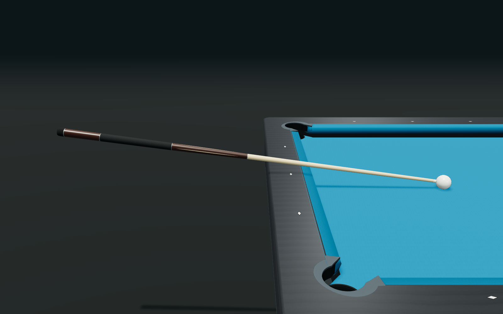
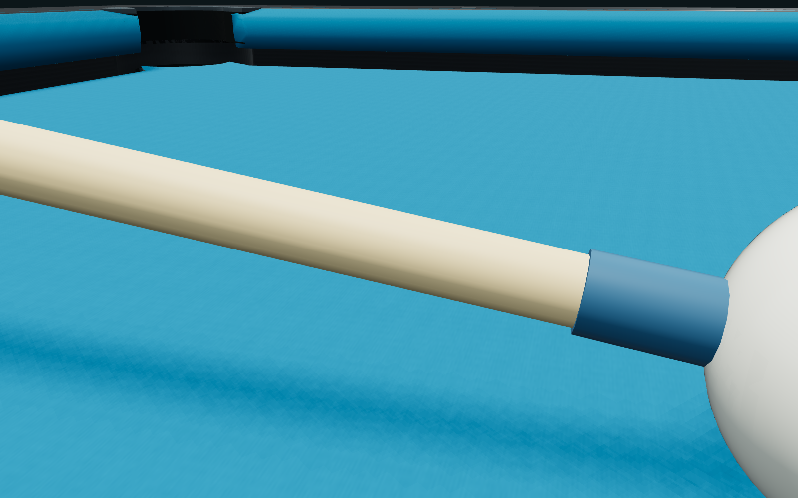
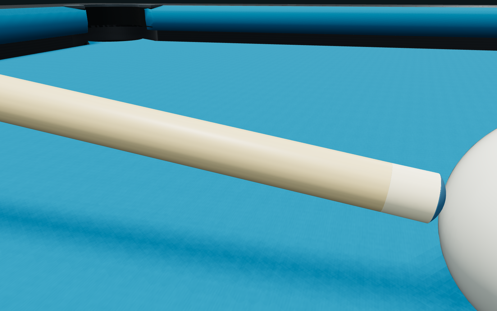
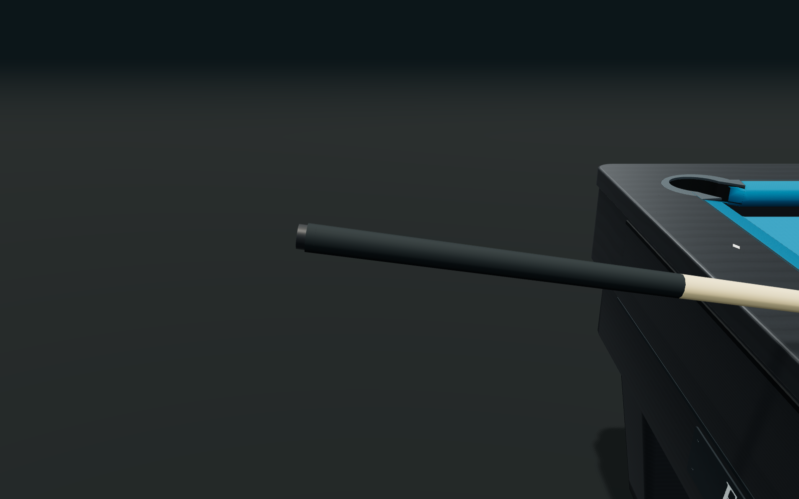
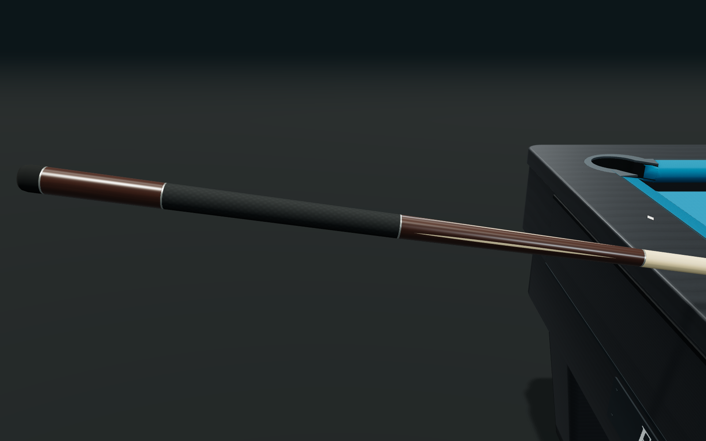

# FRAME v0.75 — queue américaine

15 novembre 2026.

La queue mesure 1,47 m : fût en érable clair, avant et talon en bois sombre,
quatre incrustations courbes, poignée tressée, bagues métalliques de 2 mm,
virole ivoire et procédé bleu bombé. Le talon se termine par un tampon en
caoutchouc. Les incrustations suivent le cône du bois, sans ailettes ni ombre
supplémentaire. Leurs triangles dégénérés aux pointes sont éliminés.

`dist/cue-model.js` construit la géométrie avec des matériaux injectés, sans
DOM ; `dist/cue-materials.js` fournit huit matériaux et quatre textures locales
déterministes. Les quinze maillages et les quatre textures (trois de 128 × 256,
une de 64 × 64, soit 400 Kio RGBA avant mipmaps) sont créés une fois au démarrage.
Le grain des cylindres suit leur longueur ; la tresse reste mate.

L'axe local +X pointe vers la bille. Le sommet du procédé reste exactement à
`(-0.035, 0, 0)` ; la longueur supplémentaire va vers l'arrière jusqu'à
`x=-1.505 m`. L'intégration dans `game.js` se limite aux imports et à la
construction de `cueGroup`. La pose dynamique, la caméra, le geste et les
paramètres de frappe sont conservés. Le modèle physique reste `reference-v069`.

## Comparaisons visuelles

Captures Chromium / WebGL 2 logiciel, 1 600 × 1 000, polices externes bloquées,
entraînement avec la blanche seule, direction +X, effet centré et élévation 8°.
Pour les deux versions, les vues regardent un point de l'axe local transformé
en coordonnées monde ; la caméra est décalée de ce point par le vecteur monde
indiqué. Ces caméras de contrôle et l'accès temporaire aux variables du module
sont injectés seulement par l'outil de capture, sans modification livrée du jeu.

| Vue | Point local X | Décalage caméra monde (X, Y, Z), mètres |
| --- | --- | --- |
| Ensemble | -0.77 | (0, 0.60, 1.55) |
| Procédé | -0.085 | (0.028, 0.040, 0.103) |
| Partie arrière | -1.13 | (0, 0.26, 0.65) |

Ensemble avant / après :

Procédé avant / après :

Partie arrière avant / après :

## Vérifications

- État initial : 260 tests réussis sur le commit `c268a36`.
- Suite finale `npm test` : **265 tests réussis**, aucun échec, ignoré ou annulé.
- Tests de la queue : ancre/longueur, raccords axiaux et radiaux, incrustations
  plaquées et orientées vers l'extérieur, triangles des incrustations d'aire positive et budget
  de géométrie. Matériaux testés sans DOM.
- Relecture réciproque par les agents géométrie et matériaux, puis contrôle des
  captures par le coordinateur et l'agent matériaux. Les premiers cadrages trop
  serrés ont été remplacés par les vues ci-dessus.
- Navigateur : WebGL 2 actif, aucune erreur JavaScript ; tir en jauge avec effet
  et élévation, puis arrêt ; replay ouvert, curseur déplacé, lecture reprise et
  fermeture. Capture réelle du pointeur, sélection d'effet, recul puis frappe
  via les événements du gestionnaire souris en mode geste. L'avancement jusqu'à
  l'arrêt utilise la boucle du jeu avec horloge accélérée et rendu intermédiaire
  suspendu : c'est un contrôle fonctionnel, pas une mesure de fluidité.
- Le sommet du procédé transformé coïncide avec `spinContactPoint` pour neuf
  combinaisons : effets (0,0), (0.2,-0.15), (-0.35,0.3) et élévations 0°, 8°, 15°.
  Erreur maximale observée : 0 m dans ce contrôle navigateur, en mode geste.
  Les trois caméras restent accessibles.
- Après cinq réinitialisations, compteurs stables à 316 géométries et 11 textures
  dans cette scène d'entraînement (contre 306 et 7 avant). Ces compteurs ne
  mesurent pas les performances sur les appareils des joueurs.
- `node scripts/export-table-geometry.mjs` : export strictement identique à celui
  du commit initial, 155 maillages et 34 308 triangles. Physique, géométrie
  partagée des poches et éclairage inchangés.

Les gestes ont été automatisés sous Chromium logiciel ; le ressenti de la
souris sur matériel réel et les autres navigateurs restent à apprécier.
