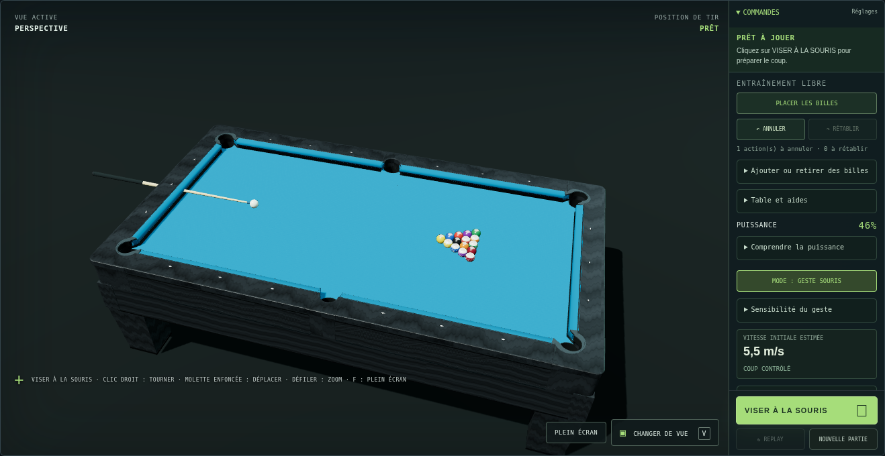
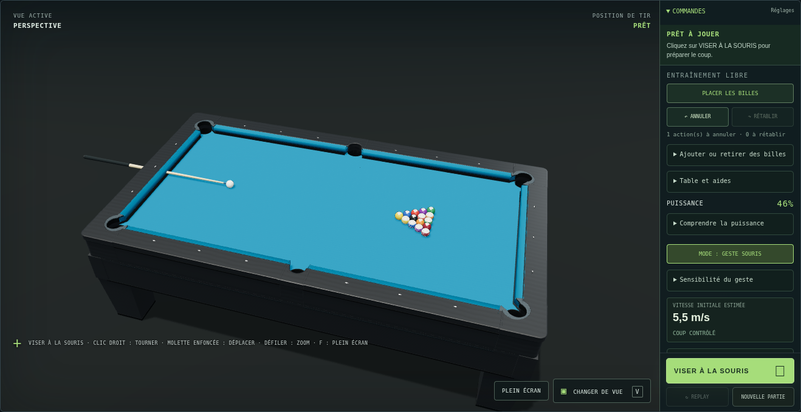

# FRAME v0.72 — matériaux et éclairage

12 novembre 2026. Cette mise à jour conserve la table graphite et le tapis bleu.
Elle améliore leur rendu sans remplacer les objets par des modèles externes.

## Modifications

- Cadre : fibres fines et peu contrastées, relief réduit, finition satinée sans
  composante métallique. L'intensité des reflets du cadre est limitée séparément
  de celle des billes pour conserver un aspect graphite.
- Tapis : microtrame et relief plus discrets, bleu ajusté pour l'éclairage neutre.
- Billes : même finition de résine sur le corps, les bandes et les disques des
  numéros. Les numéros réagissent maintenant à l'éclairage, aux reflets et aux
  ombres ; leur fond transparent est découpé par un test alpha.
- Éclairage : lumière principale plus zénithale, remplissage frontal et exposition
  ajustée. Le filtrage PCF des ombres utilise un rayon plus large, avec une seule
  carte d'ombre de 2 048 × 2 048.
- Reflets : environnement de salle construit localement et préfiltré une seule
  fois en PMREM 128. Il représente des panneaux lumineux réfléchis, sans ajouter
  de luminaires à la scène visible ni charger de fichier HDR externe. Les objets
  temporaires et le générateur sont libérés après ce calcul.

Aucune équation, coefficient, règle de jeu, collision ou position de surface n'a
été modifiée. `reference-v069` reste le modèle actif. Les textures sont toujours
procédurales ; aucune dépendance npm ni ressource de modèle 3D n'est ajoutée.

## Relecture croisée par deux agents

1. Avant modification, les agents matériaux et éclairage ont chacun examiné le
   plan de l'autre. Des captures v0.71 ont été conservées.
2. Après la première étape table/tapis et éclairage, chacun a relu le code de
   l'autre puis les mêmes captures perspective et dessus. La comparaison a
   révélé un dessus trop métallique et une façade trop sombre.
3. Corrections : réduction de l'intensité des reflets et du vernis du cadre,
   déplacement du remplissage vers l'avant ; revue réciproque des correctifs.
4. Étape billes : revue du matériau éclairé et de sa découpe alpha, avec contrôle
   de la gestion des ressources et examen rapproché des numéros avant livraison.

L'intégration vérifie séparément les captures, le comportement et la portée du
diff. Ces revues servent au contrôle du rendu et du code ; elles ne constituent
pas une nouvelle validation de la physique.

## Comparaison

Même taille de fenêtre (1 600 × 1 100), mêmes vues et formation d'entraînement,
Chromium avec WebGL 2 logiciel. Les très petits écarts aléatoires du triangle
restent ceux du jeu ; les captures ne sont pas une comparaison pixel par pixel.

Avant :

Après :

## Vérifications de livraison

- `npm test` : 252 tests réussis, aucun échec, ignoré ou annulé.
- Comparaison exacte de l'export géométrique avant/après : mêmes 162 maillages
  de table et mêmes 31 844 triangles (hors sol). Les surfaces de collision et
  les fichiers de physique restent inchangés.
- Chromium / SwiftShader : perspectives, dessus et vue joueur sans erreur
  JavaScript ni avertissement graphique ; examen rapproché des numéros par
  les deux agents. Le fin cerclage imprimé des numéros existait déjà.
- Tir en entraînement jusqu'à l'arrêt, en passant par l'intégrateur réel du
  jeu ; compteur à `01`, replay terminé disponible, ouverture, déplacement
  du curseur et fermeture vérifiés.
- Cinq réinitialisations de triangle : compteurs GPU stables à 321 géométries
  et 22 textures. Avant mise à jour : 321 et 21 ; la texture supplémentaire
  est l'environnement de reflets. Cela ne remplace pas un profilage mémoire
  prolongé sur plusieurs appareils.
- Pour une même vue joueur, appels de dessin 304 → 274 et triangles dessinés
  162 674 → 136 754 : suppression de la seconde passe transparente des
  30 disques de numéro. Ce sont des compteurs de rendu ; les maillages ne sont
  pas simplifiés et cela ne garantit pas un gain de fréquence d'images.
- Chargement du jeu et tir sans réseau externe : les polices Google sont
  volontairement bloquées et les polices de remplacement prennent le relais.
  Leur erreur réseau attendue est distincte des erreurs JavaScript du jeu.

Les mesures de rendu proviennent d'un navigateur logiciel à résolution fixe,
pas d'un téléphone ni d'une carte graphique de jeu. L'environnement est
précalculé une fois au démarrage ; aucune capture PMREM n'est faite par image.

Pour reproduire le contrôle visuel : lancer le serveur décrit dans le README,
choisir Entraînement puis Triangle de 8, inspecter les trois vues avec V, tirer
en mode jauge et vérifier le replay. Passer ensuite entre les formations pour
vérifier que le rendu reste correct après réinitialisation.
