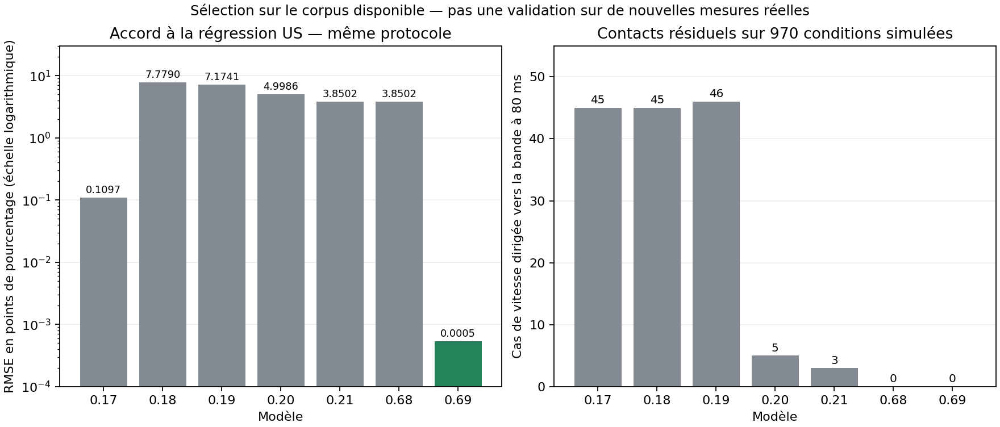

# FRAME v0.69 — sélection du modèle sur le corpus de pool américain

11 novembre 2026.

## Décision et portée

Le modèle par défaut devient **`reference-v069`**. Il reprend la base empirique
américaine de v0.17, lui ajoute la correction géométrique de contact de v0.68
et calcule plus précisément la transition glissement–roulement.

Il obtient la plus faible RMSE parmi les **sept candidats implémentés**, dans
chacun des groupes quantitatifs examinés, avec respect des contrôles d'énergie,
de non-pénétration et de convergence. Aucun coefficient matériel n'a été ajusté.

Cela signifie « meilleur accord au corpus exploitable avec ces contraintes »,
**pas** « minimum universel d'erreur sur toutes les tables réelles ». Les cibles
chiffrées proviennent d'une régression déjà utilisée pour construire les
modèles. Il n'y a pas de nouvelles mesures indépendantes de pool avec effet.

## Pourquoi repartir de v0.17

La v0.17 reproduit directement la loi de sortie TUM issue d'impacts de pool.
Les variantes mécaniques plus détaillées v0.18 à v0.68 n'obtiennent pas un
meilleur accord sur ce corpus. Leur complexité n'est pas un critère de choix.

La v0.17 présentait toutefois deux limites numériques/mécaniques :

- Sur la matrice de diagnostic, **45 conditions** conservent une vitesse
  dirigée vers la bande à 80 ms, dont **10 obtenues par la frappe du jeu**.
- Le moteur pouvait forcer le roulement lorsqu'il restait moins de **0,002 m/s
  de glissement**. Cette approximation perturbe la vitesse du premier roulement,
  qui est précisément l'observable utilisée pour la comparaison américaine.

La v0.69 corrige ces deux points. La dernière fraction de glissement est
intégrée jusqu'à sa transition analytique, avec une tolérance numérique de
`1e-9 m/s`. La translation et la rotation restent liées par les équations de
la sphère homogène. Les versions archivées gardent leur ancienne tolérance.
La détection des collisions et la prévision de trajectoire utilisent les
mêmes équations et le même modèle de précision que la simulation effective.

Les coefficients de glissement, roulement, rotation verticale, restitution
et frottement de bande ne sont pas retouchés pour obtenir un meilleur score.

## Sources : ce qui est scoré, ce qui ne l'est pas

| Référence | Utilisation |
|---|---|
| Nierhoff, Heunisch & Hirche, *Strategic play for a pool-playing robot*, régression rapportée sur 1 217 impacts de pool | Cibles quantitatives américaines, pour arrivée en roulement naturel sans effet latéral. Les points sont calculés avec la régression, pas des mesures brutes indépendantes. |
| Mécanique de la sphère et dérivations exposées par Kiefl/Pooltool | Tests théoriques du tapis, des transitions et des symétries. Pas une nouvelle mesure du frottement de notre table. |
| Alciatore, HSV B.15 / TP B.6, environ 50 % de vitesse après le glissement d'un rebond normal | Repère indicatif uniquement : vitesse et table précises non attachées à ce nombre. Il n'est pas transformé en cible exacte à 1,6 m/s. |
| Règles de la tangente et des 30° | Diagnostics idéalisés/approximatifs, pas des mesures à minimiser au détriment du frottement bille–bille. |
| Mathavan 2009 ; montage reproduit de Mathavan 2010 | Repères snooker ou billes non US : exclus du score pool. Les anciennes comparaisons restent visibles, avec leur nature explicitée. |
| Han/Tailuge | Carambole/trois-bandes : méthodes seulement, ni coefficients ni trajectoires importés comme données américaines. |
| Étude de choc 2023 sur PVC ; constantes de contacts multiples Gismeros 2022 | Conditions différentes ou modèle de recherche : pas de transfert de constantes dans ce modèle actif. |

Le score ne mélange jamais des mètres par seconde, des degrés et des points
de pourcentage dans une somme arbitraire. Le laboratoire affiche désormais
le score des **27 composantes pool** séparément des collisions de snooker et
du repère indicatif d'Alciatore.

PDF TUM : https://mediatum.ub.tum.de/doc/1155344/988748.pdf

Dérivations mécaniques consultées :
https://github.com/ekiefl/ekiefl.github.io/blob/main/_posts/pooltool/2020-04-24-pooltool-theory.md

Les PDF académiques originaux restent non revérifiés intégralement dans cet
environnement à accès réseau restreint. Les coefficients de la régression
et la classification de source réutilisent les références déjà documentées
dans le projet ; aucune acquisition de données brutes n'est prétendue ici.

## Protocole corrigé, identique pour tous les candidats

L'ancienne comparaison partait 2 mm avant la bande et employait la vitesse de
départ comme vitesse incidente. Elle repérait aussi la fin du glissement à
l'aide d'un petit glissement résiduel. Cela rendait l'écart publié sensible à
l'approche et à l'approximation numérique de la transition.

Le protocole actuel :

1. Prescrit l'état incident **au contact**, en roulement naturel.
2. Vérifie la vitesse et l'angle au moment de l'impact avec l'observation
   `onBeforeRailContact`.
3. Attend le **premier véritable état de roulement**, sans glissement, après
   le choc ; ne confond pas cet instant avec la sortie immédiate de bande.
4. Emploie le même pas de mesure `0,0001 s` pour tous les candidats.
5. Recommence avec des pas plus fins pour contrôler l'erreur de mesure restante.

Les anciens scores ne sont pas effacés. Ils figurent dans le JSON sous
`legacyProtocol`. Par exemple, v0.17 et v0.69 gardent toutes deux **0,081029**
point avec l'ancien protocole. Il serait incorrect de comparer ce nombre
ancien à celui d'un seul modèle mesuré avec le nouveau protocole.

## Résultats sur les groupes de références

Toutes les valeurs ci-dessous sont des **RMSE en points de pourcentage des
rapports de vitesse**, avec le même protocole corrigé.

| Modèle | 24 composantes obliques TUM | 3 composantes normales TUM | 24 composantes d'interpolation | Grille supplémentaire, 40 composantes |
|---|---:|---:|---:|---:|
| v0.17 empirique | 0,109708 | 0,064514 | 0,055826 | 1,285829 |
| v0.18 | 7,778967 | 0,064514 | 7,784123 | 9,044069 |
| v0.19 | 7,174068 | 0,064514 | 7,415171 | 9,323194 |
| v0.20 | 4,998551 | 1,736934 | 4,047381 | 6,429566 |
| v0.21 | 3,850213 | 2,155068 | 3,209869 | 5,135186 |
| v0.68 | 3,850213 | 2,155068 | 3,209869 | 5,135186 |
| **v0.69 référence** | **0,000538** | **0,000538** | **0,000415** | **1,276680** |

Le modèle sélectionné est meilleur en RMSE, MAE et pire écart sur chacun des
trois premiers groupes. Sur la grille supplémentaire, il a la meilleure RMSE
et MAE, mais pas le meilleur pire écart : voir la limite ci-dessous.

La grille principale utilise 0,5 / 1,2 / 2,3 m/s et 30° / 45° / 60° / 75°.
Les chocs normaux utilisent les mêmes vitesses. L'interpolation emploie
0,8 / 1,6 / 2 m/s et 20° / 40° / 55° / 70°. La grille supplémentaire emploie
0,35 / 1 / 1,8 / 2,7 m/s et 10° / 25° / 50° / 65° / 80°.

Ces groupes sont tous dérivés de la **même régression publiée**. Ils vérifient
l'interpolation et la couverture numérique, pas une indépendance expérimentale.
Le très petit écart de v0.69 montre surtout la reproduction fidèle de cette
équation. Il ne constitue pas une précision de trajectoire réelle garantie.

### Contrôle de résolution de la mesure

Sur les 24 composantes obliques :

| Pas de mesure | v0.17 | v0.69 |
|---|---:|---:|
| 0,000100 s | 0,109708 | 0,000538 |
| 0,000050 s | 0,111242 | 0,000387 |
| 0,000025 s | 0,114272 | 0,000195 |

L'erreur résiduelle du nouveau modèle diminue avec le pas de mesure. Dans
l'ancien, l'approximation de fin de glissement reste dominante. Aucun
coefficient physique n'a été ajusté à ces trois pas.

### Une limite conservée et publiée

À **2,7 m/s et 80°**, le nouveau modèle garde un écart de **8,0744 points**
sur la composante tangentielle. La v0.17 avait 8,0642 points à cet endroit,
soit un écart légèrement plus faible par compensation numérique.

Reproduire exactement la régression à ce point demanderait un frottement
**effectif** d'environ 1,208, alors que l'enveloppe opérationnelle du projet
est plafonnée à 0,9. Ce plafond est une borne numérique prudente, pas une
mesure ni une limite universelle de gomme. Il n'est pas relevé pour gagner
sur un seul point calculé, sans preuve expérimentale de ce régime rasant.
La publication ne donne pas ici des bornes d'échantillonnage assez précises
pour prétendre valider cette extension à partir des mesures brutes.

Le modèle ne minimise donc pas chaque point possible d'une extrapolation.
Il minimise les scores du corpus retenu avec les contraintes conservées et
rend les limites visibles.

## Contrôles mécaniques des sept candidats

Chaque modèle est examiné sur **970 conditions**, soit **2 910 simulations**
avec cas normal, cas miroir et pas de temps quatre fois plus fin :
700 états imposés, plus 270 états produits par la frappe du jeu.
Cela représente **20 370 simulations** pour les sept modèles.

| Modèle | Cas de vitesse résiduelle vers la bande à 80 ms |
|---|---:|
| v0.17 | 45, dont 10 issus de la frappe |
| v0.18 | 45 |
| v0.19 | 46 |
| v0.20 | 5 |
| v0.21 | 3 |
| v0.68 | 0 |
| **v0.69** | **0** |

Les 34 contrôles analytiques du tapis passent pour chaque candidat.
Le modèle sélectionné passe également les contrôles d'énergie, de symétrie,
de convergence et l'assistance de trajectoire. Les coefficients du tapis
restent `mu_s=0,20`, `mu_r=0,01`, et `spinningFriction=0,015`.



La suite logicielle, les diagnostics dans Chromium, le replay et une casse
complète en jeu sont contrôlés en complément. Les versions antérieures et
le profil snooker conservent leurs calculs archivés.

## Reproduire et tester dans le jeu

```bash
npm test
node scripts/study-pool-models.js
```

Le script ne recherche pas de nouveaux coefficients : il compare les
candidats, applique les critères mécaniques, classe les scores et vérifie
la dominance sur les trois premiers groupes. Tous les cas non résolus et
les points supplémentaires difficiles sont conservés dans les sorties.

[Résultats complets JSON](data/pool-model-selection-v069.json).

Dans le jeu, sélectionner **Pool v0.69 · Référence US + contact corrigé**,
ou un ancien modèle pour comparer. Le laboratoire conserve les 57 lignes,
avec un score pool séparé, un diagnostic de bande rasante et les observations
de vitesse/rotation avant et après le premier choc.

## Ce que cette étude ne peut pas établir

Aucune campagne de tirs US indépendants, avec vitesse angulaire mesurée, n'a
été ajoutée. La restitution des effets sur une vraie table, le matériau K55/K66,
les variations entre tapis et les petits envols restent à valider.
La formule choisie est la plus fidèle au corpus américain exploitable parmi
les candidats testés et avec les contraintes annoncées ; elle n'est pas une
preuve de réalisme universel.
